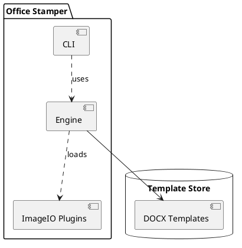
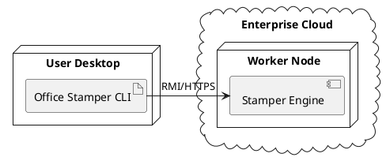
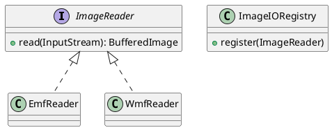

Architectures fail from poor visibility more often than from bad code. You
spend so long on the implementation that the structure and distribution go
unseen. These diagrams make the "where" and "what" visible, and they live in the
same Git repo as the code.

## Component diagrams

When a system grows past a handful of classes, component diagrams model the
logical parts and their interfaces.

I show these in dev meetings instead of code. A new joiner sees the module
boundaries and why we don't allow circular dependencies between the CLI and the
engine.

## Deployment diagrams

A good architecture on paper is useless if the deployment is a mystery.
Deployment diagrams map software artifacts to hardware and execution
environments.

I keep a PlantUML file open during architecture meetings and update it live.
The minutes of the meeting are a versionable diagram.

## Class diagrams

Class diagrams define the static structure of a system.

These are the backbone of Domain-Driven Design discussions, keeping everyone on
the same mental model of the domain.

## Object diagrams

Class diagrams show what can be; object diagrams show what is. They're snapshots
of a system at a point in time.

When I debug the `IIORegistry`, I add a small helper that prints the current
registry state as PlantUML. Seeing the actual instances and their connections is
better than reading a stack trace.

## Archimate

At enterprise scale, [Archimate](https://plantuml.com/fr/archimate-diagram) links
technical implementation to business goals and strategic capabilities.
