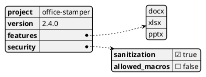
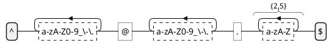
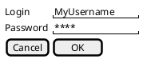
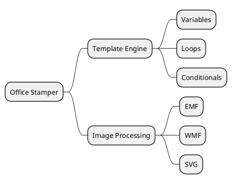

Not every diagram models architecture. Some of the most useful ones are quick
sketches: the shape of a data structure, a regex, a GUI mockup, or a
brainstorming tree. PlantUML covers these too, and they stay in plain text.

## JSON and YAML

PlantUML's [JSON](https://plantuml.com/fr/json) and
[YAML](https://plantuml.com/fr/yaml) support turns raw data into a readable
tree.

Because it's trivial to make software print PlantUML-format text, I add debug
endpoints that return JSON or YAML this way. Instead of parsing a thousand log
lines, a developer hits an endpoint and sees the current configuration as an
image.

## Regular expressions

PlantUML can
[visualize regular expressions](https://plantuml.com/fr/regex), turning a
cryptic string into a state machine.

From a security standpoint, visualizing schemas and validation logic means the
developer and the auditor see the same thing.

## Salt for GUI mockups

[Salt](https://plantuml.com/fr/salt) is PlantUML's wireframing language. It's
about function and flow, not pixel-perfect design.

I use it with business analysts. When they describe a feature, I type a Salt
mockup instead of writing a spec. If they want the OK button on the left, I move
it in two seconds.

## MindMaps

When I start a new module, I map requirements and edge cases with a
[MindMap](https://plantuml.com/fr/mindmap-diagram).

The text form means the ideas can be copied straight into task descriptions.
