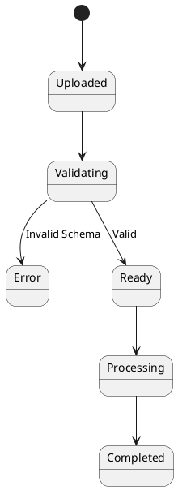
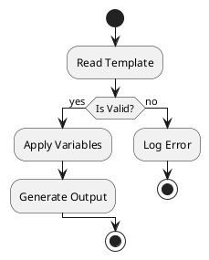
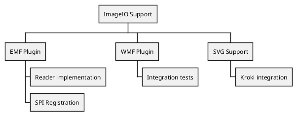
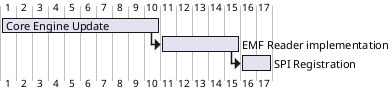

Structure diagrams show what a system is made of. Process diagrams show what it
does, in what order, and when. These are the ones I use most when the logic gets
hard to hold in my head.

## State diagrams

[State diagrams](https://plantuml.com/fr/state-diagram) model life cycles.

They're the common language with business analysts. We walk through "what
happens if validation fails" before any code is written.

## Activity diagrams

For business processes or algorithm flow, the
[activity diagram](https://plantuml.com/fr/activity-diagram-beta) has a cleaner
syntax.

I trace the happy path and the error paths live, and by the end of the session
the diagram is most of the implementation plan.

## Work breakdown structure

Before a timeline, a [WBS](https://plantuml.com/fr/wbs-diagram) breaks the work
down.

## Gantt charts

Once the tasks exist, a [Gantt](https://plantuml.com/fr/gantt-diagram) maps them
to time.

Seeing dependencies mapped in the same repo as the code makes them a shared
constraint, not a manager telling people to hurry.
